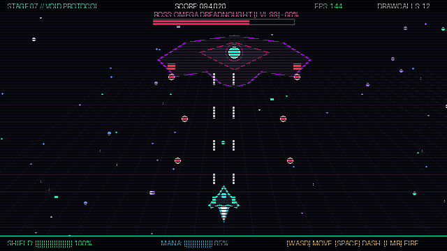

<!-- Hero banner -->

  

# SWAGAT SOURAV DHAR
### IoT Developer · Full-Stack Engineer · AI Explorer

  
  
  
  
  

---

### About

I’m a **B.Tech CSE (Internet of Things)** student building systems where hardware, software, and AI meet.

- **Currently building:** [TrailGuard / SWAAS](https://github.com/SWAGAT10241/Smart-Wearable) — wearable safety & health monitoring
- **Learning:** Linux, Java, Python, embedded systems, backend design
- **Interests:** IoT, real-time systems, AI-assisted safety, full-stack development
- **Open to:** Internships, hackathons, student collaborations, open-source

---

### Flagship project — TrailGuard / SWAAS

**AI-assisted wearable safety & health monitoring**

ESP32-based wearable + Node.js backend + React dashboard for real-time health monitoring, GPS, fall detection, and emergency workflows.

| Layer | Stack |
| :--- | :--- |
| **Hardware** | ESP32, sensors (vitals / motion / environment), GPS |
| **Backend** | Node.js, Express, MongoDB, WebSockets, JWT, Google OAuth |
| **Frontend** | React, Vite, Tailwind, MapLibre GL |
| **Focus** | Telemetry pipeline, auth, real-time dashboard, testing |

> Status: **actively developed**. Features and performance depend on ongoing hardware validation and testing.

---

### Other projects

| Project | Description | Tech |
| :--- | :--- | :--- |
| **[Smart Home Energy Advisor](https://github.com/SWAGAT10241/Smart-Home-Energy-Advisor-Agent)** | AI energy guidance with dashboards, appliance tracking, and what-if savings | Python, Flask, IBM watsonx.ai Granite |
| **[Assistant](https://github.com/SWAGAT10241/Assistant)** | Full-stack assistant with auth and interactive chat | React, Node.js, Express, MongoDB, JWT |
| **[AICTE IDEA Lab](https://github.com/SWAGAT10241/AICTE_IDEA_Lab)** | Applied AI, embedded systems, deep learning, robotics lab work | Jupyter, Python, embedded |

---

### Playground — Cyber-Pulse: Void Breaker

A small browser arcade loop (canvas + Web Audio). Fun demo — not a commercial game engine.

  
   
  Canvas game loop · boss fight · keyboard + touch controls · optional DualSense vibration API

<b>How to play the demo</b>

- **Move:** `A` / `D` or `←` / `→`
- **Fire:** `Space`
- **Parry:** `E`
- On mobile, use on-screen buttons in the full HTML demo (`index.html`)

---

### Tech & skills

  

  

| Area | Working with |
| :--- | :--- |
| **Embedded / IoT** | ESP32, sensors, telemetry, GPS |
| **Backend** | Node.js, Express, REST, WebSockets, JWT |
| **Frontend** | React, Vite, responsive UI |
| **Data** | MongoDB |
| **AI** | Exploring watsonx.ai / intelligent monitoring |
| **Systems** | Linux basics, Git, GitHub Actions |
| **Design** | Fusion 360 (learning), UI prototyping |

> Icons show technologies I’m actively using or learning — not a claim of expert-level mastery in every tool.

---

### GitHub telemetry

---

### Learning roadmap

- [ ] Strengthen Java & Python fundamentals
- [ ] Data structures & algorithms practice
- [ ] Deeper Linux / shell skills
- [ ] Reliable embedded & IoT pipelines
- [ ] Stronger API design & security
- [ ] CI/CD and automated testing
- [ ] More Fusion 360 / hardware prototyping
- [ ] Meaningful open-source contributions

---

### Let’s connect

Open to internships, collaborations, and conversations around **IoT**, **embedded systems**, **AI**, and **full-stack** work.

**Build. Test. Learn. Ship.**

[GitHub](https://github.com/SWAGAT10241) · [LinkedIn](https://linkedin.com/in/swagat-sourav-dhar) · [X](https://x.com/Swagat10241) · [Email](mailto:swagatsourav10241@gmail.com)

 

Profile assets & demo · SWAGAT10241

<!---
SWAGAT10241/SWAGAT10241 is a special repository — this README appears on the GitHub profile.
--->
