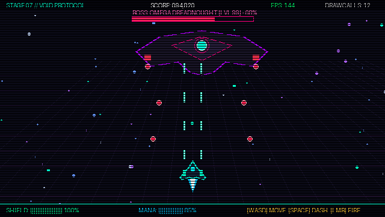

<!-- PlayStation OS Dynamic Seasonal Weather Banner -->

  

[+%C2%B7+Bhubaneswar;Open+to+collaborations+%26+internships)](https://github.com/SWAGAT10241)

  
  
  
  
  

---

### 👨‍💻 About Me

I'm **Swagat Sourav Dhar**, an IoT developer and full-stack engineer from **Bhubaneswar**, specializing in systems where hardware telemetry, responsive web interfaces, and intelligent automation intersect.

- 🛠️ **Building:** [TrailGuard / SWAAS](https://github.com/SWAGAT10241/Smart-Wearable) — smart wearable safety & vitals monitoring ecosystem  
- 🎮 **Creating:** [Cyber-Pulse: Void Breaker](https://swagat10241.github.io/SWAGAT10241/) — PlayStation OS browser arcade with Web Audio & dynamic seasonal weather  
- 🎯 **Focus:** IoT architectures, embedded systems (ESP32), Node.js backends, React frontends  

---

### 🚀 Flagship Project — TrailGuard / SWAAS

> **Smart Wearable Assistance & Alert System** — Connected ESP32 wearable hardware coupled with a real-time Express backend and React telemetry dashboard for health vitals, GPS tracking, and automated fall detection.

| Layer | Technologies |
| :--- | :--- |
| **Embedded & Hardware** | ESP32, heart-rate/SpO₂, motion & environment sensors, GPS |
| **Backend & Telemetry** | Node.js, Express, MongoDB, WebSockets, JWT, Google OAuth |
| **Frontend Dashboard** | React 18, Vite, Tailwind CSS, MapLibre GL |

---

### 🕹️ Interactive Playground — Cyber-Pulse: Void Breaker

A high-performance browser arcade simulation and PlayStation-themed console OS playground featuring **real-time seasonal weather** (snowfall, falling leaves, raindrops), **Web Audio synthesizer**, and **DualSense vibration**.

  

---

### 🛠️ Tech Stack & Tools

  

  

---

### 📊 GitHub Activity

 

---

  Designed &amp; maintained by <a href="https://github.com/SWAGAT10241">Swagat Sourav Dhar</a>

